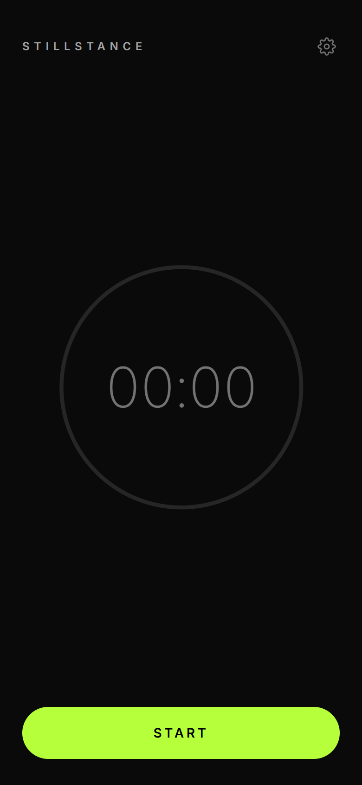
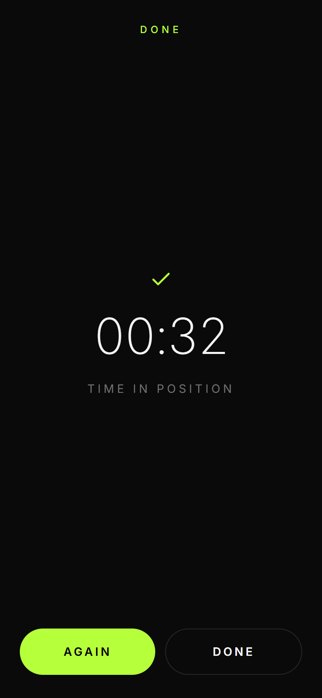

<div align="center">

# STILLSTANCE

**Time in position.**

A beautiful, privacy-first timer for open-ended stretch holds.

</div>

---

You don't know how long you'll hold a stretch — so STILLSTANCE counts **up**, not down. Press start, get into position during a short countdown, hold as long as you can, stop. That's the whole app. One purpose, zero distractions.

## Screenshots

<!-- Screenshots live in docs/screenshots/ (repo-hosted, no external image services).
     Capture at ~390×844 (iPhone-ish portrait) from the production build.
<p align="center">
  
  
  
  
</p>
-->

_Screenshots coming with the first release._

## Features

- **Open-ended count-up timer** — no preset durations, no plans, no exercise library
- **Automatic preparation countdown** (0/3/5/10 s) so you can get into position hands-free
- **Accurate timing** — timestamp-derived, immune to tab throttling and backgrounding
- **Pause / resume / repeat**
- **Screen Wake Lock** — the display stays on while you hold (where supported)
- **Optional feedback** — vibration, generated sounds, milestone cues at 30/60/90/120 s
- **Offline-first installable PWA** — works with no connection at all
- **Zero tracking, zero external requests, no account, no backend**
- **Self-hostable** — one `docker compose up -d` away

## Privacy

STILLSTANCE is private by architecture, not by policy:

- **No accounts, no analytics, no telemetry, no cookies, no fingerprinting.**
- **Zero external requests.** Fonts (Inter, bundled via Fontsource, [OFL-1.1](https://github.com/rsms/inter/blob/master/LICENSE.txt)), icons, and every other asset ship with the app. Nothing is loaded from Google, any CDN, or any third party.
- **Local-only data.** The only thing stored anywhere is your settings, in your browser's `localStorage`.
- **Verifiable.** Open DevTools → Network: after loading, every request targets the app's own origin. The codebase is small enough to audit in an afternoon.

## Quick start (development)

Requires Node.js >= 22.

```bash
git clone https://github.com/<you>/stillstance.git
cd stillstance
npm ci
npm run dev
```

## Self-hosting with Docker

```bash
docker compose up -d
```

The app is then available at `http://localhost:8080`. Set `PORT` to change the host port:

```bash
PORT=3000 docker compose up -d
```

The image is a multi-stage build: Node builds the static bundle, then an **unprivileged nginx (alpine)** serves it with strict security headers (CSP, `nosniff`, `Referrer-Policy`, `Permissions-Policy`). Multi-arch base images — runs on a VPS, home server, or Raspberry Pi.

### HTTPS / reverse proxy

The container serves plain HTTP and does **not** handle TLS. Terminate HTTPS at your reverse proxy (Caddy, Traefik, Nginx Proxy Manager):

```text
Internet → Reverse proxy (HTTPS) → stillstance container (HTTP :8080) → static PWA
```

Example Caddyfile:

```caddy
stretch.example.com {
    reverse_proxy localhost:8080
}
```

> **Note:** PWA installation and the Screen Wake Lock API require a secure context — use HTTPS (or `localhost`) for full functionality.

## Architecture

- **Timer engine** ([src/features/timer/engine.ts](src/features/timer/engine.ts)) — elapsed time is always `accumulatedMs + (now − runningSince)`, computed from `Date.now()` timestamps. No tick counting, so rendering delays, browser throttling, and backgrounding cannot corrupt the time. Negative clock jumps are clamped.
- **State machine** ([src/features/timer/machine.ts](src/features/timer/machine.ts)) — a hand-rolled reducer: `idle → preparing → running ⇄ paused → finished`. Invalid events are ignored, which eliminates double-tap races by construction.
- **Wake Lock** ([src/features/wake-lock/useWakeLock.ts](src/features/wake-lock/useWakeLock.ts)) — acquired during a session, re-acquired after visibility changes, silently absent on unsupported browsers.
- **Settings** — a single versioned `localStorage` key with per-field fallback parsing.
- **PWA** — `vite-plugin-pwa` precaches the entire build (~220 KB); the app is fully functional offline after the first visit.

Stack: Vite · React · TypeScript · Tailwind CSS. Runtime dependencies: `react`, `react-dom`, `@fontsource-variable/inter` — that's the complete list.

## Development

| Command | Purpose |
| --- | --- |
| `npm run dev` | Development server |
| `npm test` | Unit + component tests (Vitest) |
| `npm run lint` | ESLint |
| `npm run typecheck` | TypeScript check |
| `npm run build` | Production build |
| `npm run preview` | Serve the production build |

CI runs lint, typecheck, tests, the production build, and a Docker build validation on every PR — no secrets required, forks work out of the box.

## Contributing

See [CONTRIBUTING.md](CONTRIBUTING.md) — including the scope guardrail and the zero-dependency policy.

## Security

See [SECURITY.md](SECURITY.md) for how to report vulnerabilities.

## License

[AGPL-3.0](LICENSE). You are free to use, study, modify, and self-host STILLSTANCE. If you distribute a modified version — including hosting one as a service — you must make its source available under the same license.
